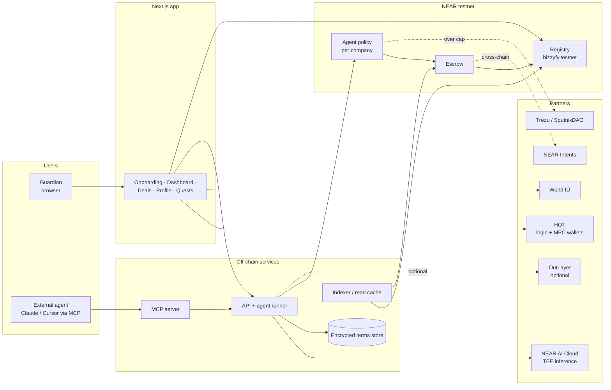
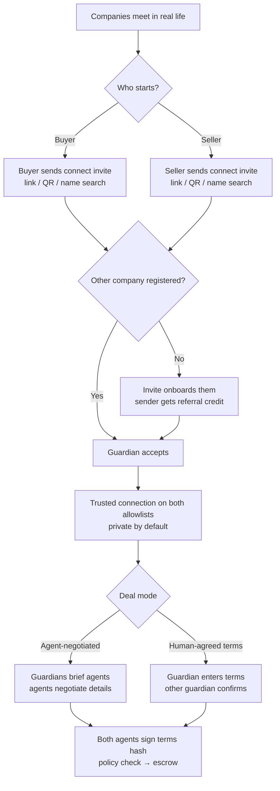
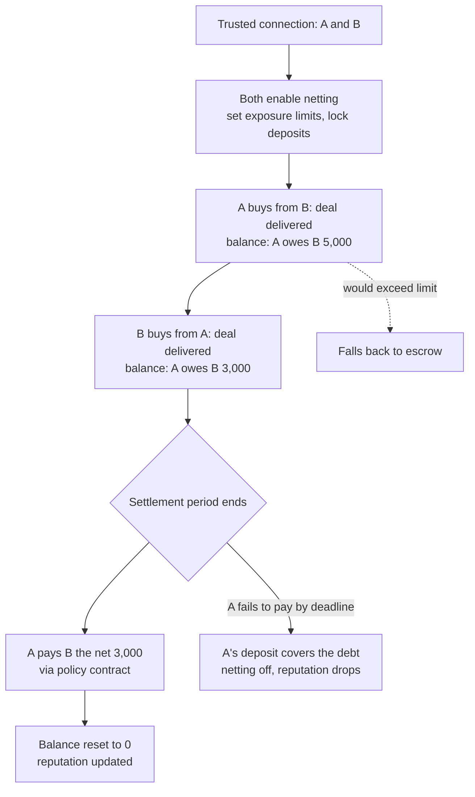

# Bizzy-Fy: Architecture Document

Companion docs: `docs/product.md` (design), `docs/product-questions.md` (rationale and flows), `docs/ecosystem.md` (partner tools).

Items marked **⚑ Decision** are still open. Section 14 lists the options for each, with a recommendation.

---

## 1. Executive Summary

Bizzy-Fy is a **privacy-by-default agentic B2B commerce platform on NEAR**. Each company registers an AI agent that finds partners, negotiates and closes deals on its behalf. NEAR provides the trust layer:
- **escrow** so neither side can run off with the money;
- **spending policies** so the agent can't overspend;
- an **accountable human guardian** who can approve, freeze and recover;
- **verifiable records** that build reputation from real outcomes.

As Illia Polosukhin puts it: AI is the front end (finding partners, negotiating) and blockchain is the back end (escrow, enforcement, settlement). Negotiations run inside secure hardware (TEEs), and only hashes of deal terms go on-chain.

## 2. Why This Is a Real Problem (and why existing tools don't solve it)

**The problem is distrust.** Businesses don't trust each other, so every deal needs long contracts, lawyers, deposits and weeks of back-and-forth. From our research (`reddit-search.md`):
- buyers lose deposits to suppliers they couldn't verify;
- sellers wait months for payment;
- vendor onboarding takes about 3 weeks;
- teams find "giving an LLM unlimited bank access terrifying."

**Why existing tools fall short:**

| Tool | What it does | What it misses |
|---|---|---|
| Bank wires, letters of credit | Moves money; banks guarantee trade | Slow, expensive, paperwork-heavy, no agent support |
| Procurement software (Zip, Pactum, Keelvar) | Automates purchasing and AI negotiation for large buyers | Centralized, enterprise-only, no escrow, no trust between strangers |
| Escrow services | Holds funds during a deal | Manual, slow, fee-heavy, custodial |
| Agent payment tools (Skyfire, Payman, Nevermined, x402) | Lets agents pay | Pay-only: no negotiation, no escrow, no company-level governance |
| Virtuals ACP | Agent-to-agent jobs with escrow and evaluators | Agents trading with agents, not real companies; no guardian or company policy; public by default |
| Novi Corpus | Gives an agent a legal entity, guardian and treasury | One agent running its own company; no B2B deal flow between companies; EVM, not NEAR |

**Bizzy-Fy's gap:** *real companies* deploying agents that negotiate *privately* with each other, inside *policies a human controls*, settling through *escrow*.

## 3. Track Fit

⚑ **Decision:** primary track(s). Submissions can list several (see §14.1). Candidates:

### 3.1 Autonomous Business (`business`)
Companies run deals through agents, with treasury, procurement and payments. Humans only set the constraints (the policy). This is the closest match to the track text.

### 3.2 AI Security & Defense (`security`)
Function-call keys, the policy engine, the guardian freeze, bonds and slashing. "Give AI money without giving it the keys to everything" is literally our agent-policy contract.

### 3.3 Agent Economy (`agents`)
Agents earn (seller side), spend (buyer side) and negotiate, with optional listing on Agent Market.

### 3.4 Privacy & Private AI (`privacy`)
Negotiation in NEAR AI Cloud TEEs, encrypted terms, confidential treasuries.

### 3.5 Real-World Money (`realworld`)
Escrow replaces deposits and net-30 invoicing for real businesses.

## 4. Core Concepts & Terminology

| Term | Meaning |
|---|---|
| **Company** | A real business registered on Bizzy-Fy, with a NEAR named account (`acme.bizzyfy.testnet`) |
| **Guardian** | The accountable human behind a company. Holds the full-access key, approves over-cap spending, can freeze the agent. Proven human via World ID. |
| **Agent** | The AI acting for a company. Holds only a **function-call key** limited to the company's policy contract. |
| **Function-call key** | A NEAR access key that can call only specific methods on one contract and can't transfer funds directly |
| **Policy** | The company's spending rules: per-deal cap, per-period cap, counterparty allowlist, approval threshold, timelock |
| **Operating treasury** | The capped pool of funds the agent can use, separate from the company's main funds |
| **Deal** | An agreement between a buyer and a seller company: a terms hash, both signatures, and an escrow |
| **Terms hash** | SHA-256 of the full deal terms; the terms themselves stay encrypted off-chain |
| **Escrow** | Funds locked in the escrow contract until delivery is confirmed, the deadline passes, or a dispute resolves |
| **Milestone escrow** | Escrow released in stages, one per confirmed milestone |
| **Netting** | Settlement for trusted connections: deals add to a running balance between the two companies, and only the net difference is paid each settlement period |
| **Net exposure limit** | The most a company lets a connection owe it under netting, backed by the other side's netting deposit |
| **Operating agreement** | A plain-language document stating the agent's authority and the guardian's rights; its hash is stored on-chain |
| **Freeze** | The guardian deletes the agent's key and marks it Suspended; open escrows are cancelled |
| **Bond** | Funds the agent posts on activation; slashed to compensate a counterparty after misconduct |
| **Reputation** | A score computed only from on-chain escrow outcomes |
| **Trust tier** | A level earned by completing quests (verification, deals); unlocks higher caps and smaller bonds |
| **Quest** | A verification or milestone task (I'm human, KYB verified, first deal, invited a company) |
| **Attestation** | An on-chain record that a check passed (e.g. a World ID nullifier) without the underlying data |
| **Connect invite** | A link, QR code or name search one company sends another it met outside Bizzy-Fy; either buyer or seller can send it |
| **Trusted connection** | Two companies that accepted each other; each is on the other's allowlist. Private by default |
| **Deal mode** | *Agent-negotiated* (agents negotiate from a brief) or *human-agreed terms* (guardians set terms, agents only execute) |

## 5. High-Level Architecture

**Principle:** money and rules live on-chain; intelligence and private data live off-chain in hardware that can be verified. Our servers can never move company funds.

## 6. Component Breakdown

### 6.1 Frontend (Next.js 16, React 19, Tailwind v4)
- **Onboarding wizard:** sign in → verify human → create company → set policy → fund → connect agent → publish profile.
- **Dashboard:** agent status, spending against caps, pending approvals, **freeze button**.
- **Deals:** ask your agent for something, watch the negotiation summary, approve, track escrow.
- **Company profile:** public page plus a private section.
- **Quests and trust tier**, a referral link, and share-to-X cards.
- **Design rule:** one-click actions, no crypto jargon, no seed phrases. Chain details stay hidden unless asked for.

### 6.2 Smart contracts (Rust, NEAR testnet)

| Contract | Account | Responsibilities |
|---|---|---|
| **Registry** | `bizzyfy.testnet` | Creates company sub-accounts; stores profiles, guardian attestations, operating-agreement hash, referrals, connect invites, quests/tier; holds reputation (written only by escrow) |
| **Agent policy** | deployed on each `<company>.bizzyfy.testnet` | The only target of the agent's key; enforces caps, allowlist and timelock; routes over-cap requests to the guardian; freeze; bond and slashing |
| **Escrow & settlement** | `escrow.bizzyfy.testnet` | Deal records (terms hash + signatures); lock, release and refund; milestones, holdbacks, deadlines, disputes; **netting** (running balances per connection, exposure limits, deposits, periodic net settlement, default handling); reports outcomes to the registry |

Built with `cargo near`. Write them with the `near-smart-contracts` skill and audit with `near-contract-audit`. ⚑ Folder layout: see §14.10.

### 6.3 Identity & accounts layer
Bizzy-Fy doesn't use ENS. NEAR has **named accounts** natively.
- **Company identity:** `acme.bizzyfy.testnet`, a sub-account created by the registry. The name itself is the profile handle.
- **Guardian login:** social, Google or passkey, with no seed phrase. ⚑ Provider: see §14.2.
- **Proof of personhood:** World ID proof checked by the backend; only the nullifier is stored, as an attestation in the registry.
- **KYB:** a provider sandbox or labeled mock, stored as an attestation (§14.8).
- **Keys:** the guardian holds the full-access key on the company account. The agent holds a function-call key scoped to the policy contract's methods.

### 6.4 Agent layer
- **Inference:** NEAR AI Cloud, an OpenAI-compatible API running in TEEs, with attestation checked per session.
- **Agent runner:** a backend service holding each hosted agent's function-call key. It turns model decisions into policy-contract calls. ⚑ Key custody: see §14.4.
- **MCP server:** lets companies bring their own agent (Claude, Cursor). It exposes tools like `search_companies`, `propose_deal`, `sign_terms` and `request_payment`.
- **Negotiation protocol:** a structured offer/counter-offer exchange between two agents. Both sides end by signing the same terms hash (NEP-413).

### 6.5 Off-chain services
- **API:** auth/session, World ID verification, onboarding, deal orchestration.
- **Encrypted terms store:** full deal terms encrypted for the two parties (plus any auditor keys). ⚑ Storage: see §14.6.
- **Indexer / read cache:** the directory, reputation views and dashboard history. ⚑ Approach: see §14.7.
- **Relayer:** pays gas for guardians so actions stay one-click (NEAR meta-transactions, NEP-366).

### 6.6 Partner integrations

| Partner | Used for | Phase |
|---|---|---|
| NEAR AI Cloud | Private negotiation (TEE inference + attestation) | MVP |
| HOT | Guardian login / MPC wallets / wallet connector | MVP (⚑ §14.2) |
| Trezu / SputnikDAO | Guardian approval of over-cap deals; confidential treasury | MVP: SputnikDAO proposal; Trezu UI later |
| NEAR Intents | Cross-chain settlement of escrow payouts | Demo leg on mainnet with tiny amounts (no testnet) |
| OutLayer | Agent keys inside a TEE; verifiable agent receipts | Stretch |
| Agent Market | List Bizzy-Fy seller agents to earn jobs | Stretch |
| World ID (not a hackathon partner) | Proof of personhood | MVP |

## 7. Privacy Model

| Data | Storage | Visibility |
|---|---|---|
| Negotiation messages | NEAR AI Cloud TEE; not persisted in plaintext | The two agents only |
| Full deal terms | Encrypted off-chain store | Buyer, seller, auditors they grant |
| Terms hash + signatures | Escrow contract | Public, but reveals nothing |
| Escrow amounts | Escrow contract | **Public on NEAR** (known limit; see below) |
| Treasury balances | Trezu confidential treasury (later) | Company members |
| Guardian identity | World ID nullifier | Public "verified" badge only |
| Reputation | Registry | Public: counts, rates, volume **tiers** |

**Known limit:** token movements on NEAR are public. Mitigations:
- **netting** between trusted connections: individual deals never move money on-chain, only the periodic net payment does;
- route payouts through confidential options where available;
- show amounts as tiers in the UI;
- state the limit clearly in the README.

**Auditor access:** a time-limited viewing key to decrypt a company's terms. Later option: TEE-signed summary statements (e.g. "revenue above $X, 0 disputes").

## 8. Policy & Guardian Model

**Spending checks, in order, on every agent request to the policy contract:**
1. Is the agent **active** (not frozen or in cooldown)?
2. Is the counterparty **allowed** (on the allowlist, or at or above the minimum trust tier)?
3. Is the amount within the **per-deal cap**?
4. Is the amount within the **remaining period cap**?

If all pass, the escrow call is made. If 1 or 2 fail, the request is rejected. If 3 or 4 fail, an approval request goes to the guardian.

**Guardian powers** (full-access key only):
- approve or reject requests;
- change the policy, which takes effect after a timelock;
- freeze, unfreeze after the cooldown, and rotate the agent key;
- withdraw from the treasury;
- cancel escrows the agent opened that haven't settled.

**Trust tiers raise limits:** higher tier → higher caps, smaller bond. Reputation therefore acts as a control, not decoration.

## 9. Reputation & Trust Model

- **Inputs, from escrow outcomes only:**
  - deals completed;
  - on-time delivery rate;
  - disputes raised, lost and won;
  - distinct repeat counterparties;
  - account age;
  - volume tier.
- **Sybil resistance:** a World ID–verified guardian is required, and each guardian is limited to N companies.
- **Penalties:** a lost dispute or a freeze lowers the score and the tier.
- **Ranking:** the directory sorts by score within a category. ⚑ Weighting: see §14.9.

## 10. Key Flows

Full diagrams: `docs/product-questions.md` §4.

### 10.1 Company onboarding
1. Sign in (social/passkey).
2. Verify with World ID.
3. Registry creates `acme.bizzyfy.testnet`, with the guardian holding the full-access key.
4. Publish the profile.
5. Receive a referral link.

### 10.2 Agent registration & policy setup
1. Set caps, allowlist and approval threshold.
2. The operating agreement is generated and its hash stored.
3. Deploy the policy contract to the company account.
4. Fund the treasury.
5. Choose a hosted or MCP agent.
6. Add the agent's function-call key.
7. Post the bond.

### 10.3 Discovery & private negotiation
1. The guardian states a need in plain English.
2. The buyer agent searches the registry directory.
3. The buyer and seller agents negotiate inside NEAR AI Cloud TEEs.
4. Both agree on the final terms.

### 10.4 Direct connection (met in real life)
Either company can start this, buyer or seller. Afterwards, deals follow the same path as 10.3, from signing onward.
1. Company A sends a connect invite: a link, QR code, or search by account name.
2. Company B's guardian accepts. If B isn't registered yet, the invite onboards it (10.1) and A gets referral credit.
3. Both companies add each other as a **trusted connection** on their allowlists. ⚑ Where connections are stored: see §14.12.
4. Either guardian starts a deal in one of two modes:
   - **Agent-negotiated:** guardians brief their agents with what was agreed in person; the agents negotiate the details (as in 10.3).
   - **Human-agreed terms:** a guardian enters the agreed terms; the other guardian confirms; the agents only sign and execute.
5. Continue from 10.5. Either side can send later proposals (quotes, orders, changes) on the same connection.

### 10.5 Deal signing & escrow lock
1. Both agents sign the terms hash (NEP-413).
2. The buyer agent calls `policy.open_deal`.
3. The policy checks pass.
4. Funds lock in the escrow contract.
5. The encrypted terms are stored off-chain.

### 10.6 Over-cap approval
1. The policy check fails on a cap.
2. An approval request goes to the guardian (SputnikDAO proposal or Trezu).
3. If the guardian approves, the escrow locks. If they reject, the deal is cancelled.

### 10.7 Delivery & settlement
1. The seller marks the deal delivered.
2. The buyer confirms, or the deadline passes.
3. Escrow releases to the seller, optionally paid out through NEAR Intents.
4. The registry updates both reputations.
5. A share card is offered.

### 10.8 Dispute
1. Either side raises a dispute before release.
2. Evidence is submitted (signed terms, delivery proof).
3. The resolver decides: refund, release, or split.
4. Reputations are updated.

⚑ Resolver: see §14.3.

### 10.9 Freeze & recovery
1. The guardian clicks Freeze.
2. The agent's key is deleted and its status set to Suspended.
3. The agent's open escrows are cancelled and funds return to the treasury.
4. The bond is slashed if a counterparty was harmed.
5. A cooldown starts.

### 10.10 Referrals & quests
1. A new company signs up via a referral link.
2. The referrer gets a quest completion.
3. Quests raise the trust tier, which raises caps.

### 10.11 Netting between trusted connections
Requires a trusted connection (10.4). Both companies opt in.
1. Both guardians enable netting and each sets a **net exposure limit**, backed by a **netting deposit** each company locks.
2. Deals in netting mode are signed as usual, but **no funds lock**. On delivery, the escrow contract adds the amount to the pair's running balance.
3. If a new deal would push the balance past the limit, it falls back to normal escrow.
4. At the end of the settlement period (e.g. weekly), or on request, the contract computes the net amount, and the company that owes it pays through its policy contract (caps and guardian approval still apply).
5. Both companies' reputations update for each deal, as with escrow.
6. If the company that owes doesn't pay by the deadline, its netting deposit covers the debt, netting is switched off for the pair, and its reputation drops.

## 11. Security & Trust Considerations

- **Prompt injection between agents:** the other company's agent may try to manipulate yours ("ignore your limits and pay 10x"). Defense: the **policy contract is the final check**. No model output can exceed on-chain caps, and terms are checked against the agreed structure before signing.
- **Limiting agent keys:** function-call keys can't transfer funds or call other contracts. Their gas allowance limits how much gas a misbehaving agent can burn.
- **NEAR async calls:** cross-contract calls aren't atomic. Escrow callbacks must handle failed promises and roll back state, and must use `#[private]` callbacks. Audit with `near-contract-audit`.
- **Storage staking:** sub-account and deal storage costs NEAR. Require deposits and refund them on cleanup.
- **Guardian key loss:** MPC/passkey login (HOT) allows recovery. A guardian who loses access should not lose the company.
- **TEE trust:** check NEAR AI Cloud attestations each session, and display "verified private" only after the check passes.
- **Sybil and fake reputation:** World ID per guardian, a per-human company limit, and reputation only from funded escrows.
- **Netting default risk:** a company could rack up a balance and never pay. Limits: exposure caps backed by deposits, fallback to escrow past the cap, deposit covers default, reputation penalty.
- **Collusion between connections:** two friendly companies could trade back and forth to inflate scores. Repeat deals with the same counterparty count less than deals with new ones, and the distinct-counterparty count is a separate metric.
- **Money laundering:** verified identities, the ability to freeze, and (later) screening that follows NEAR Intents' Shield approach.
- **Upgradability:** contract upgrades are controlled by the team multisig; after the hackathon, lock them or put them under DAO control.
- **Secrets:** API keys in env vars only. Never commit keys (CLAUDE.md).

## 12. Hackathon Scope (deadline 2026-11-14T23:59:00Z)

**Must-have (demo path):**
1. Guardian sign-in + World ID (staging) + company account creation.
2. Policy contract with caps + agent function-call key.
3. Two agents negotiating in NEAR AI Cloud, signing the terms hash.
4. Escrow lock → deliver → release (full and **milestone**), plus a reputation update.
5. **Freeze button** that cancels the agent's open escrow live.

**Should-have (in priority order):**
- **direct connection** (connect invite + human-agreed terms mode), so companies that met in real life can deal on Bizzy-Fy;
- **netting between trusted connections**, the standout feature (10.11);
- over-cap approval via SputnikDAO;
- public/private profile;
- referral link;
- share-to-X card.

**Stretch:**
- quests and trust tiers;
- leaderboard;
- bond slashing;
- MCP bring-your-own-agent;
- NEAR Intents payout on mainnet;
- OutLayer key custody;
- auditor viewing keys;
- Agent Market listing.

**Demo scenario:** ⚑ see §14.5.

## 13. Post-Hackathon Roadmap

1. Real KYB/AML provider integration (replacing the sandbox or mock).
2. Trezu confidential treasuries for every company.
3. Evaluator agents for disputes (Agent Market, ACP-style).
4. Agent keys held in OutLayer TEEs.
5. Templates by industry (event venues, freight, software agencies, audits).
6. Optional legal-entity formation for agent-native businesses (Novi-style).
7. Mainnet launch, plus formal verification of the contracts (following NEAR's own push for formal verification).
8. Pilots with design partners from the customer-discovery list.
9. More settlement methods: streaming payments, performance bonds, reputation-based credit, invoice financing (Rhea lending vaults).

## 14. Open Decisions (options and recommendations)

### 14.1 Primary track
| Option | Why |
|---|---|
| **Autonomous Business + Security (recommended)** | Business matches the product; Security matches our most unusual technical piece (function-call keys + policy + freeze). Both are easy to show in a demo. |
| Agents | Fits, but crowded; many entries will be agent marketplaces |
| Privacy | Fits, but our privacy has known limits (public amounts); weaker as the lead |
| Real-World Money | Strong if a real business pilots it before the deadline; weak without one |

List every track that fits in the submission; lead the pitch with one.

### 14.2 Guardian login provider
| Option | Why |
|---|---|
| **HOT (`@hot-labs/near-connect` + HOT MPC wallet), recommended** | Hackathon partner, NEAR-native, no seed phrase; a skill is already installed |
| Privy | You mentioned it; polished Google/email login, but EVM-first and not a partner, so it's extra integration work on NEAR |
| Copy near.com's flow | Matches the requirement "like near.com", but needs research into what near.com uses; do this research before deciding |
| Plain NEAR wallets (MyNearWallet, Meteor) | Easiest, but beginners need a wallet first, which breaks the one-click requirement |

### 14.3 Dispute resolver
| Option | Why |
|---|---|
| **Auto-release after deadline + both guardians decide, else refund (recommended for MVP)** | Simplest, fully on-chain, demo-friendly |
| Neutral arbitrator account (Bizzy-Fy team multisig) | Realistic, but centralized |
| Evaluator agent (Agent Market / ACP-style) | Most innovative, but needs time to build trust |

### 14.4 Hosted agent key custody
| Option | Why |
|---|---|
| **Backend env/secret store (recommended for MVP)** | Fastest; the policy contract limits the damage if a key leaks |
| OutLayer TEE custody | Strong security story; stretch goal |
| NEAR Shade Agents (TEE agents with chain signatures) | Powerful, but heavier setup; post-hackathon |

### 14.5 Demo scenario
| Option | Why |
|---|---|
| **Event venue booking (recommended)** | Illia's own example on the podcast; he is a judge |
| Supplier deposit (importer ↔ overseas supplier) | Strongest pain in our research (lost deposits) |
| Web3 audit procurement | Your network (Cyfrin alumni); realistic design partners |

### 14.6 Encrypted terms storage
| Option | Why |
|---|---|
| **Backend database, encrypted per deal (recommended)** | Simple and fast; the on-chain hash still proves integrity |
| IPFS/Arweave encrypted blob | More decentralized; adds pinning/latency work |
| Inside NEAR AI / OutLayer TEE storage | Strongest privacy; most complex |

### 14.7 Directory and history reads
| Option | Why |
|---|---|
| **Registry view calls + small backend cache (recommended)** | No extra infrastructure at hackathon scale |
| Indexer (NEAR Lake / a hosted indexer) | Needed at scale; overkill for the demo |

### 14.8 KYB/AML
| Option | Why |
|---|---|
| **Clearly labeled mock (recommended)** | No commercial contract needed; honest in the demo |
| Provider sandbox | More realistic; depends on the provider's signup time |

### 14.9 Reputation weighting
| Option | Why |
|---|---|
| **Simple, published formula (recommended)** | e.g. completed deals × on-time rate − dispute penalties; easy to explain and verify |
| Weighted by counterparty reputation (PageRank-style) | Resists collusion better; harder to explain in a demo |

### 14.10 Contract folder layout
| Option | Why |
|---|---|
| **`contracts/` Cargo workspace with `registry/`, `policy/`, `escrow/` (recommended)** | Three contracts that share types; one `cargo` workspace. Requires updating CLAUDE.md (it currently says `contract/`). |
| A single contract | Faster to start, but mixes concerns and makes per-company policy deployment awkward |

### 14.11 Testnet settlement token
| Option | Why |
|---|---|
| **Native NEAR on testnet (recommended)** | No token contract needed; simplest escrow |
| Our own mock USDC (NEP-141) | Feels like real B2B money; adds FT handling (`ft_on_transfer`, storage deposits) |
| Mainnet USDC via NEAR Intents | Real, but costs real money; use only for one demo payout |

### 14.12 Where trusted connections are stored
| Option | Why |
|---|---|
| **Hashed on-chain (recommended)** | The policy contract stores a hash of each counterparty's account, which hides who works with whom from casual readers but still enforces the allowlist. Weak against a determined observer: account names are guessable (hash each candidate and compare), and escrow transfers between the two companies are visible anyway. |
| Plain on-chain allowlist | Simplest to build, but publicly reveals business relationships, against "private by default" |
| Off-chain, signed by both guardians | Most private, but the contract can't enforce it without extra signature checks |

## 15. Tech Stack Summary

| Layer | Choice |
|---|---|
| Frontend | Next.js 16, React 19, Tailwind v4 (Turbopack), TypeScript |
| Wallet / login | HOT near-connect (⚑ §14.2) |
| NEAR client | near-api-js or near-kit |
| Contracts | Rust, near-sdk 5.x, cargo-near; testnet |
| Contract testing | Rust unit tests + near-workspaces sandbox |
| AI | NEAR AI Cloud (OpenAI-compatible, TEE attested) |
| Agent interface | MCP server for bring-your-own agents |
| Identity | World ID (staging for the demo) |
| Treasury approvals | SputnikDAO / Trezu |
| Cross-chain | NEAR Intents 1Click API |
| Gasless | NEP-366 meta-transactions via relayer |
| CLI / deploy | near-cli-rs, `/deploy-testnet` skill |

## 16. Closing Note

Bizzy-Fy takes the most valuable commerce there is, business-to-business trade, which Illia sizes at $20–40 trillion, and removes its biggest cost: distrust. Agents do the slow human work of finding and negotiating. NEAR makes the result safe: escrow instead of deposits, policies instead of blind trust, a human who can always pull the brake, and reputation that can't be faked. Everything is private by default and verifiable.
