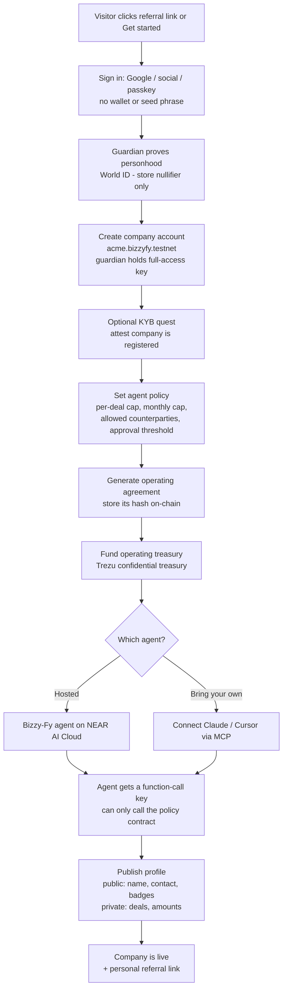
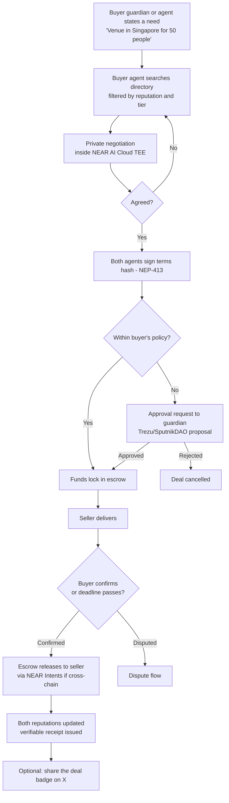
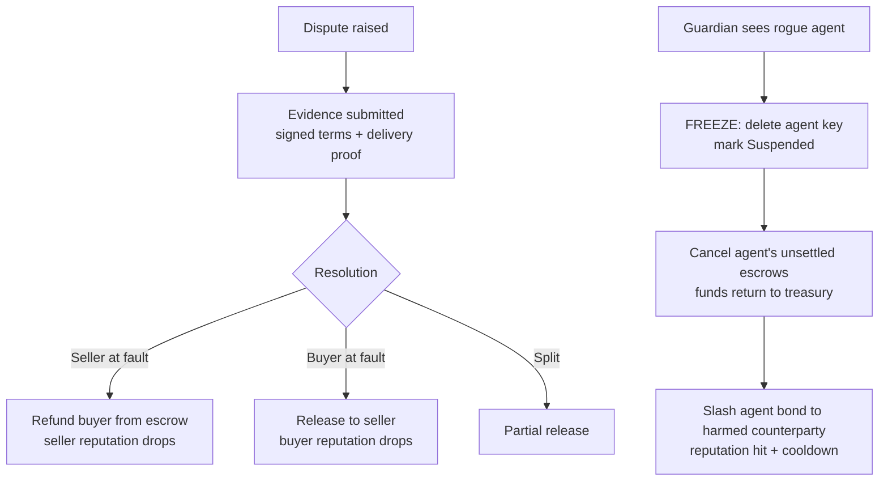

# Bizzy-Fy: Key Product Questions

Answers to the core design questions behind Bizzy-Fy. Read alongside `docs/product.md` (the design) and `docs/ecosystem.md` (partner tools).

**Sources used:**
- Illia Polosukhin's 1kx podcast interview (excerpt, 38:44–48:30)
- `reddit-search.md` (pain-point research)
- `links.md` (Virtuals ACP notes)
- The customer-discovery sheet "NEAR Hackathon Customer Discovery Leads". As of 2026-11-07 it lists 71 leads (AI agent teams, B2B businesses, procurement experts) with outreach sent on 4–5 Nov, but **no replies yet**. Nothing below is backed by interviews; update this file when replies come in.

---

## 1. How will Bizzy-Fy be decentralized, private by default, and verifiable?

### Decentralized: no one, including us, holds companies' money or can block a deal

- **Settlement and rules live in contracts on NEAR**, not on our servers. Escrow, spending policies and reputation records are Rust contracts that anyone can read and call.
- **Self-custody.** Each company's NEAR account is controlled by its own guardian's key. Bizzy-Fy never holds full-access keys, so we can't move a company's funds.
- **Bring your own agent.** A company can use our hosted agent or connect its own (Claude, Cursor or any MCP client). The contracts treat both the same.
- **Partners, not one platform.** Payments use NEAR Intents, treasuries use Trezu/SputnikDAO, and AI runs on NEAR AI Cloud. Each is independent infrastructure.

**Where we are still centralized (say so to judges):**
- our web app and the backend that hosts agents;
- the AI provider (NEAR AI Cloud);
- the identity provider (World ID).

**Mitigations:**
- the contracts keep working without our frontend;
- open-source code;
- AI runs in hardware that can be checked (below).

### Private by default: deal details are visible only to the parties

| Data | Where it lives | Who can see it |
|---|---|---|
| Negotiation messages | Inside NEAR AI Cloud's TEE (sealed hardware) | Only the two agents; not even the AI provider |
| Final deal terms | Encrypted off-chain | Buyer, seller, and any auditor they grant a viewing key |
| On-chain deal record | Hash of terms + both signatures + escrow state | Public, but reveals nothing about the terms |
| Treasury balances | Trezu confidential treasury | Company members only |
| Identity | World ID nullifier and KYB attestations, never documents | Public only as a "verified" badge |
| Reputation | Counts, rates, volume **tiers** | Public by design, but no individual deals |

**Honest caveat:** NEAR is a public blockchain. Plain token transfers into escrow show amounts and accounts. To hide them, use confidential options where available (Trezu confidential treasuries, NEAR Intents confidential swaps) and keep amounts off-chain where possible. We should state this limit, not hide it.

### Verifiable: anyone can check what happened without trusting us

- **The contracts** are open source with reproducible builds (`cargo near build reproducible-wasm`), so anyone can confirm the deployed code matches the repo.
- **Deals:** both agents' signatures (NEP-413) over the terms hash prove both sides agreed to the same thing.
- **AI:** NEAR AI Cloud provides cryptographic attestation that the negotiation ran inside genuine secure hardware with the stated model.
- **Agent actions:** OutLayer can produce proofs of exactly what code an agent ran on which inputs.
- **Policies:** the operating agreement's hash is stored on-chain, so the legal document and on-chain rules provably match.
- **Reputation** is computed only from escrow outcomes on-chain, so it can't be edited by us or the company.

---

## 2. Does Bizzy-Fy need a real legal entity, a human guardian, and an on-chain treasury?

### Legal entity: yes, but the company already *is* one

**Key difference from Novi Corpus:** Novi creates a *new* legal entity (a Wyoming DAO LLC) for an agent that runs its own business. In Bizzy-Fy, the agent acts **for an existing company**: a supplier, an agency, an importer. That company is already a legal entity. So Bizzy-Fy doesn't need to create one; it needs to **link the agent to the real company** and prove the link.

**Why the link is necessary:**
- **Legal recourse.** An AI agent isn't a legal person. If a deal goes wrong off-chain (goods never arrive, wrong quality), the counterparty needs a company to hold responsible. Escrow covers money, not everything.
- **Enforceable contracts.** A signed deal is only a binding contract if a legal person stands behind each signature. The agent signs *as the company's authorized representative*, like an employee with signing authority.
- **Tax and invoicing.** Businesses need invoices from a registered entity to book expenses and reclaim VAT.
- **AML/KYB.** Regulated businesses must know who they pay. "Verified business" (KYB) is what makes a company trustworthy to strangers.

**What we build:**
- a KYB quest that attests the company is registered (sandbox or mock for the hackathon);
- an operating agreement that names the agent's authority, with its hash on-chain.

**When a new entity would make sense:** an "agent-native business" with no company behind it. That's a stretch goal (Novi-style formation), not the core.

### Human guardian: yes, required

- **Accountability.** Someone must answer for the agent. A World ID–verified guardian ties every company to one real human, which also blocks fake-company spam.
- **Approvals.** As Illia describes NEAR.com's policy engine, the agent "operate[s] within a policy and then if it wants to go out of it it needs your approval… same as if you hire someone to manage money, you're not just going to give them all the money right away."
- **Emergency stop.** Agents can malfunction. The Reddit research found a research agent in a retry loop burning $200 in minutes, and spending caps that don't stop an agent "buying the wrong thing 100 times." Only a human with the master key can freeze the agent and recover funds.
- **Market demand.** Agent builders described exactly this flow in the research: agent requests → policy check → human approves if needed → limited credential → purchase.

### On-chain treasury: yes, as an *operating account*, not the company's whole bank balance

See question 5.

---

## 3. What makes traditional B2B commerce painful without agents and blockchain?

**The root problem is distrust.** Illia: "especially when we talk about actual business commerce, this is where there's actually no trust. That's why we have long legal agreements between businesses, lawyers involved, lots of back and forth redlining… because they don't trust each other."

| Pain | Evidence | What fixes it |
|---|---|---|
| **Paying deposits to suppliers you can't verify** | A Kuwait food importer wired a deposit to a Vietnamese supplier and can't get goods or money back. An Alibaba buyer asked how to verify a supplier before a 30% deposit. A small business got scammed and now requires prepayment over $400. | **Escrow:** funds lock until delivery, so neither side can run off. **Reputation** comes from real deal outcomes. |
| **Late payment** | An agency waited 3 months for $3,400 ("it's being processed"). "Net 30" really means about 40 days. A client cut ties after a polite reminder about a $500 invoice. | **Escrow** funds are proven up front and release automatically on delivery, so nobody has to chase payment. |
| **Slow vendor onboarding** | About 3 weeks even with complete documents. Manual processes and certifications are the biggest slowdowns (secondhand, via r/procurement). | **Reusable verification:** KYB and World ID attestations are done once and reused with every counterparty. |
| **Legal friction** | Long contracts, lawyers, weeks of redlining (Illia). | **Standard templates as smart contracts:** agents negotiate the variables (price, dates, milestones); the code enforces them. |
| **Cross-border payment cost and risk** | Hidden FX spreads. Payments from Nigeria get extra bank checks. Suppliers hesitate to accept stablecoins. | **NEAR Intents:** the buyer pays in any token, the seller receives what they want, settled in minutes. |
| **Manual, people-only work** | Illia's event-company example: you email them, wait for someone to search their venue database, then go back and forth. | **Agents answer instantly** from the company's own data and charge **per outcome** (per booking). |
| **Giving AI money is scary** | "Giving an LLM unlimited bank access is terrifying." Payment gateways flag agents using cards. | **Function-call keys + policy contract + guardian:** agents get limited, revocable spending power. |
| **Money laundering and fraud** | Illia: Intents is "under scrutiny from malicious actors trying to launder money," and NEAR built Shield to detect it. | **Verified identities, reputation, and freeze/recover.** |

**Market size:** Illia calls B2B commerce "the $20–40 trillion of actual economy coming on chain with AI". He argues it's a bigger opportunity than consumer agents ("getting your agent to buy groceries… is not that much improvement").

**Note from the research:** businesses complain about *payment trust* (deposits, late payment), not negotiation privacy. Lead the pitch with escrow and guaranteed payment; privacy is how we make it safe for businesses to use.

---

## 4. Flowchart: registering a company and its agent, start to finish

### A. Onboarding a company and its agent

### B. A deal between two companies

### C. When something goes wrong

**Who evaluates disputes?**
- **Hackathon:** a simple rule. Funds auto-release to the seller after the deadline unless the buyer disputes, and disputes go to the guardians or a neutral arbitrator.
- **Later:** specialist evaluator agents, like Virtuals ACP's "Evaluator" role, or hired through Agent Market.

---

## 5. Is a treasury necessary? The operating agreement, mapped from traditional B2B

**Yes, as an operating account.** Escrow needs funds the agent can reach, but only within limits. Keeping the agent's money separate from the company's main funds limits the damage if something goes wrong. It works like a **corporate card with a spending limit**, or a petty-cash float, not like handing over the company bank account.

**What a separate treasury gives us:**
- **Smaller blast radius:** a rogue agent can lose at most what's in the operating account, and caps limit even that.
- **Policies enforced by code**, not by trust.
- **A clean audit trail** for accountants and auditors.
- **Private balances** via Trezu confidential treasuries.

### The operating agreement: traditional controls → Bizzy-Fy treasury rules

Every company already runs on these rules, written down in its financial controls, purchasing policy and contracts. Bizzy-Fy turns each one into a setting enforced by code:

| Traditional B2B control | What it means | Bizzy-Fy equivalent |
|---|---|---|
| **Delegation of authority matrix** | Who may approve how much (e.g. a manager up to $5k, the CFO up to $50k) | Per-deal cap for the agent; above it, guardian approval via Trezu |
| **Budget / spending limit** | Monthly or quarterly spend per department | Rolling period cap in the policy contract |
| **Approved vendor list** | Only buy from vetted suppliers | Counterparty allowlist, or a minimum reputation tier |
| **Dual signatures / segregation of duties** | Large payments need two people; the requester isn't the approver | Multisig threshold in Trezu; agent proposes, humans approve |
| **Purchase order (PO)** | A formal order before buying | The signed terms hash = an on-chain PO |
| **Payment terms (net 30/60)** | When payment is due after the invoice | Escrow release rule: on delivery, on a date, or auto after a deadline |
| **Deposit / advance payment** | e.g. 30% upfront, 70% on delivery | Milestone escrow: partial release per milestone |
| **Retention / holdback** | Keep 5–10% until a warranty period ends | A portion stays in escrow until the warranty date |
| **Late delivery penalty** (liquidated damages) | Pay less if delivery is late | Release amount reduces automatically after the deadline |
| **Goods receipt / three-way match** | Pay only when the PO, the delivery note and the invoice agree | Release requires buyer confirmation (or an evaluator) matching the signed terms |
| **Letter of credit** (trade finance) | A bank guarantees payment to an exporter once shipping documents arrive | Escrow + delivery proof; the contract plays the bank's role |
| **Dispute resolution clause** | Negotiation → mediation → arbitration | Dispute flow (section 4C) |
| **Termination / cancellation** | How either side can exit, and what's refunded | Cancel before delivery → refund per the agreed terms |
| **Change control** | Contract changes need formal approval | Policy changes are time-locked; the guardian can veto |
| **Signing authority** | Who may legally sign for the company | The agent's on-chain authority, named in the operating agreement (hash on-chain) |
| **Audit rights** | Auditors may inspect the books | A time-limited viewing key, or a TEE-signed attestation |
| **Emergency / fraud procedures** | Freeze cards, revoke access | Freeze: delete the agent key, cancel escrows, slash the bond |
| **Indemnity / insurance** | Who covers losses | Agent bond (slashable), backed by the legal entity |

**The operating agreement document** (generated during onboarding, hash stored on-chain) then states, in plain language:
1. the company and its guardian;
2. the agent's authority and limits (the table above);
3. what needs human approval;
4. how disputes are handled;
5. the guardian's freeze and recovery rights.

---

## 6. How does traditional B2B commerce work?

Two mirrored processes. The buyer runs **procure-to-pay**, and the seller runs **order-to-cash**.

### Buyer side: procure-to-pay

1. **Need identified.** A department needs something (raw materials, a venue, software, an audit).
2. **Sourcing.** Find suppliers through search, referrals, trade platforms (Alibaba), or a formal RFQ/RFP (request for quote/proposal) to several vendors.
3. **Supplier vetting and onboarding.** Check registration, financials, references and certifications. Collect tax forms and bank details, and add the supplier to the approved vendor list. *This often takes weeks.*
4. **Negotiation.** Price, volume, delivery dates, quality standards, payment terms. Back-and-forth over email and calls.
5. **Contract.** A master services agreement (MSA) for the relationship, plus a statement of work (SOW) or order per job. Lawyers redline both. *This often takes weeks.*
6. **Internal approval.** Spend is approved according to the delegation of authority (manager → finance → CFO).
7. **Purchase order (PO).** Issued to the supplier. It becomes the reference for everything after.
8. **Payment up front (sometimes).** A deposit for new or overseas suppliers. *This is where scams hurt.*
9. **Delivery and receipt.** Goods arrive or the service is performed; the buyer records a goods receipt.
10. **Invoice and three-way match.** The supplier invoices; accounts payable checks it against the PO and the goods receipt.
11. **Payment.** Under the agreed terms (often net 30–90) by bank transfer, ACH or wire, or for cross-border trade sometimes a letter of credit. *Late payment is common.*
12. **Reconciliation and audit.** Books are updated and auditors review samples later.

### Seller side: order-to-cash

1. Marketing and sales find buyers.
2. Quote, then negotiate.
3. Credit check on the buyer (can they pay?).
4. Contract or order accepted.
5. Fulfill: produce, ship, or perform.
6. Invoice.
7. Collect payment and chase overdue invoices.
8. Handle disputes, returns and refunds.
9. Record revenue.

### Where Bizzy-Fy fits

| Traditional step | Bizzy-Fy |
|---|---|
| Sourcing + RFQ | Agent searches the directory, filtered by reputation |
| Vendor vetting/onboarding | Reusable World ID + KYB attestations + on-chain reputation |
| Negotiation | Agents negotiate privately in a TEE, in minutes |
| Contract / MSA / redlining | Standard templates; agents fill in terms; both sign the hash |
| Internal approval | Policy contract caps + guardian approval above them |
| PO | Signed terms hash on-chain |
| Deposit / letter of credit | Escrow, funded but safe for both sides |
| Goods receipt + three-way match | Buyer confirmation / evaluator checks against the signed terms |
| Invoice + payment (net 30–90) | Automatic release on delivery, cross-chain via NEAR Intents |
| Collections / chasing payment | Not needed: funds are already in escrow |
| Dispute | Evidence-based flow with refunds and reputation consequences |
| Reconciliation and audit | Verifiable on-chain records + auditor viewing keys |

This is Illia's split: **AI is the front end** (finding the partner, negotiating), and **blockchain is the back end** (escrow, enforcement, settlement).
