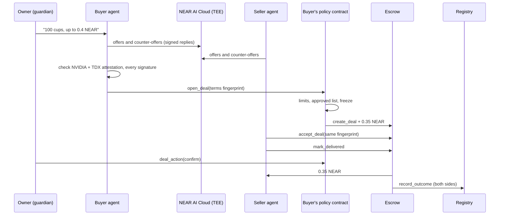

# Bizzy-Fy

> Your business's AI agent haggles with suppliers' agents inside sealed hardware, then locks the payment on NEAR until delivery, under rules the AI cannot override.

**NEAR HACKATHON 2026** ·

Tracks:

- Agent Economy (`agents`)
- Privacy & Private AI (`privacy`)
- AI Security & Defense (`security`)
- Autonomous Business (`business`)
- NFTs That Do Something (`nfts`) ·

Built on NEAR (Rust contracts, function-call keys, global contracts, NEP-171), NEAR AI Cloud, NEAR Auth, NEAR Connect, World ID

[Live app](https://bizzy-fy.vercel.app) · [Leaderboard with badges](https://bizzy-fy.vercel.app/top) · [Deployed contracts](#deployments) · [Proof it ran](#proof-it-ran) · [Try it](#try-it) · [Customer discovery](#customer-discovery)

---

## The problem

A café owner in Lagos needs 500 compostable cups every week. Ordering from a new supplier means paying a deposit up front and hoping the cups arrive, or the supplier delivering first and hoping to get paid. Haggling takes phone calls. Handing that to an AI agent is worse because an agent with a wallet can spend everything in it, and its negotiation runs on someone else's servers where prices and margins leak.

- Bizzy-Fy gives the café an agent that bargains in private, cannot spend past the owner's limits, and never hands money to a seller until the goods arrive. \*

## How it works

hh, a small café, asks its agent for "100 compostable cups, delivered this week, up to 0.4 NEAR". This happened on testnet on 10 November; every step below has a receipt.

1. **The agents bargain in private.** hh's agent and cups's agent make 7 moves on NEAR AI Cloud, inside an Intel TDX + NVIDIA TEE: 0.05 → 0.4 → 0.15 → 0.35 → 0.25 → 0.35 → accept. Code, not the AI, stops hh's agent from ever offering over 0.4 NEAR.
2. **The privacy is checked, not claimed.** The server sends a fresh nonce, checks NVIDIA's signed GPU verdict, checks that the TDX quote binds the model's signing key to that nonce, and checks every reply's signature. All three pass, so the deal shows **Verified private**.
3. **The money is locked.** The terms (100 cups, 0.35 NEAR, 5 days) are stored encrypted. Only their SHA-256 fingerprint goes on chain. hh's agent calls `open_deal` on hh's own policy contract, which checks the limits and moves 0.35 NEAR into escrow.
4. **The seller agrees to the same terms.** cups's agent calls `accept_deal` with the same fingerprint. A different fingerprint is refused.
5. **Delivery, then payment.** cups marks it delivered. hh's owner presses "It arrived: pay cups". The escrow pays 0.35 NEAR to cups and tells the registry. Both businesses' scores go up, and so do their soulbound badge NFTs: cups's is now Silver (score 36).

If the price had been over hh's per-deal limit, step 3 would have parked the deal until the owner pressed **Approve**. If cups had never delivered, anyone could have refunded hh after the deadline.



## What makes this different

- **The AI holds a key, not the money.** Each business is its own NEAR account with **no full-access key**. Its funds sit in a policy contract. The agent gets a function-call key that can only call `open_deal` and `deal_action`, with a 1 NEAR gas allowance. Spending caps, weekly limits, approvals and freeze are enforced on chain. A prompt injection can make the agent say anything; it cannot make the contract pay more.
- **Private negotiation you can verify.** Other agent marketplaces run the negotiation on their own servers. Here it runs in NEAR AI Cloud's TEE, and every negotiation stores its own proof: NVIDIA's verdict for our nonce, the key binding, and a signature check on each reply.
- **Private terms, public guarantees.** Prices and items never touch the chain. The escrow holds only the amount and a salted fingerprint, so either side can later prove what was agreed without publishing it.
- **Private trade graph.** Approved trading partners are stored as `sha256(secret salt + account)`, a different salt per direction, so nobody can read on chain who trades with whom.
- **Reputation that only real deals can write.** Scores come from the escrow contract when a deal settles. A business cannot edit its own record.
- **A track record you can't buy.** Each business's score is also a soulbound NFT (NEP-171): the registry builds the badge from the live reputation on every read, and every transfer fails with "Badges can't be moved". Any NEAR app or explorer can check it.

## Customer discovery

We checked the problem before and while building. Raw notes: [`reddit-search.md`](reddit-search.md) and [`docs/product-questions.md`](docs/product-questions.md) §3.

**1. Reddit and forum search, 5 themes** (mostly Reddit mirrors, plus Nigerian sources for cross-border payments):

| Theme                                 | What people said                                                                                                                                                                                                                                                                           |
| ------------------------------------- | ------------------------------------------------------------------------------------------------------------------------------------------------------------------------------------------------------------------------------------------------------------------------------------------ |
| Deposits to suppliers you can't check | A Kuwait food importer wired a deposit to a Vietnamese supplier and can't get the goods or the money back. An Alibaba buyer asked how to check a supplier before paying 30% up front.                                                                                                      |
| Late B2B payment                      | An agency owner waited three months for a $3,400 invoice that was "being processed". "Net 30" takes about 40 days.                                                                                                                                                                         |
| Procurement friction                  | Vendor onboarding takes about 3 weeks even with complete documents (r/procurement, quoted secondhand).                                                                                                                                                                                     |
| AI agents with money                  | "Giving an LLM unlimited bank access is terrifying." A research agent in a retry loop can burn $200 in minutes, and caps don't stop it "buying the wrong thing 100 times". The flow builders asked for: request → policy check → human approval if needed → limited credential → purchase. |
| Nigeria cross-border                  | Bank FX spreads are a hidden cost for importers, and suppliers' banks add checks to payments from Nigeria.                                                                                                                                                                                 |

**2. Cold outreach.** We built a 71-lead list (agent teams, B2B businesses, procurement experts) and contacted 48 of them on 4–5 November, with follow-ups on 11 and 13 November:

| Segment                             | Contacted | Examples                                                                                                 |
| ----------------------------------- | --------- | -------------------------------------------------------------------------------------------------------- |
| AI agent and agent-payment teams    | 30        | LangChain, CrewAI, Fetch.ai, Olas, Skyfire, Payman, Crossmint, Nevermined, Turnkey, Lit Protocol         |
| B2B businesses                      | 14        | TradeDepot and Vendease (B2B trade in Africa), 12 Web3 security and dev firms that buy and sell services |
| Procurement and negotiation experts | 4         | Pactum, Zip, Keelvar, Fairmarkit                                                                         |

46 went by email and 3 by X DM (one lead got both). As of 13 November no one has replied, so nothing here rests on interviews yet.

**3. What it changed in the build**

- **The pain is payment trust, not haggling.** Every B2B complaint was about deposits and late payment. So escrow came first: money locked before work starts, paid on delivery, refunded after the deadline, with milestones.
- **Agent builders described our policy contract.** Their request → policy → approval → limited-credential flow is exactly `open_deal` → caps → **Waiting for your OK** → a function-call key. The $200 retry loop is why **Freeze** deletes the key on chain at once, and the "wrong thing 100 times" point is why there are weekly caps as well as per-deal ones.
- **Privacy never came up**, so we kept it, but as the default rather than the headline: terms are encrypted and negotiation runs in a TEE without the user doing anything.
- **Three-week vendor onboarding** is why know-your-business (KYB) checks are the next item on the [roadmap](#roadmap).

## Architecture

Three Rust contracts on testnet, a Next.js 16 app, and a small server that hosts the agents.

### Registry ([contracts/registry/src/lib.rs](https://github.com/Kelechikizito/bizzy-fy/blob/d2190f0b7b97d16015287b1feadb2effe269c254/contracts/registry/src/lib.rs#L120-L191))

`bizzy-fy.testnet`. `create_company` creates `<name>.bizzy-fy.testnet` in one batch: create account, fund it, deploy the policy from a NEAR **global contract** by hash, and initialise it with the caller as guardian. The new account never gets a full-access key. It also holds the directory, World ID attestations (at most 3 companies per human), and reputation, which only the escrow may write ([`record_outcome`, L221](https://github.com/Kelechikizito/bizzy-fy/blob/d2190f0b7b97d16015287b1feadb2effe269c254/contracts/registry/src/lib.rs#L221-L250)).

The registry is also the NFT contract for the **score badges** ("Bizzy-Fy Track Record", symbol BIZZY). There is one token per company, its id is the company account, and the company owns it. Nothing extra is stored: `nft_token`, `nft_tokens` and `nft_tokens_for_owner` build each badge from the current reputation ([`badge`, L469](https://github.com/Kelechikizito/bizzy-fy/blob/69d4897c7f491f9be306902ecbaaad07c37b7e95/contracts/registry/src/lib.rs#L469-L496)), with the score in the title. The picture is one of four SVGs pinned on IPFS ([`contracts/assets/badges/`](contracts/assets/badges/README.md)): New, Bronze (score 1+), Silver (30+) or Gold (100+), chosen from the live score, so it changes as the business earns trust. `media` is the CID, `media_hash` its SHA-256, and the collection's `base_uri` is Pinata's gateway. `nft_transfer` and `nft_transfer_call` always fail ([L416-L438](https://github.com/Kelechikizito/bizzy-fy/blob/69d4897c7f491f9be306902ecbaaad07c37b7e95/contracts/registry/src/lib.rs#L416-L438)). New companies log a standard `nft_mint` event, and the owner logged one for the earlier companies with `emit_badges`. Check it: `near contract call-function as-read-only bizzy-fy.testnet nft_token json-args '{"token_id":"cups.bizzy-fy.testnet"}' network-config testnet now`.

### Policy ([contracts/policy/src/lib.rs](https://github.com/Kelechikizito/bizzy-fy/blob/d2190f0b7b97d16015287b1feadb2effe269c254/contracts/policy/src/lib.rs#L131-L192))

One per business, holding its money. `open_deal` runs four checks in order: frozen, approved-partner salt, per-deal cap, weekly cap. The first two refuse; the last two park the deal for the guardian. `deal_action` forwards escrow calls so the escrow sees the company as the caller. The agent may only use `accept_deal`, `mark_delivered` and `cancel` ([L17-L19](https://github.com/Kelechikizito/bizzy-fy/blob/d2190f0b7b97d16015287b1feadb2effe269c254/contracts/policy/src/lib.rs#L17-L19)). `freeze` deletes the agent's key at once and starts a one-hour cooldown ([L271-L283](https://github.com/Kelechikizito/bizzy-fy/blob/d2190f0b7b97d16015287b1feadb2effe269c254/contracts/policy/src/lib.rs#L271-L283)).

### Escrow ([contracts/escrow/src/lib.rs](https://github.com/Kelechikizito/bizzy-fy/blob/d2190f0b7b97d16015287b1feadb2effe269c254/contracts/escrow/src/lib.rs#L92-L292))

`escrow.bizzy-fy.testnet`. Deals move Proposed → Accepted → Delivered → Released, with up to 10 milestones. Timers run without a trusted party:

- the buyer has one hour to review a delivery, after which anyone can call `release_due`;
- an undelivered deal can be refunded by anyone after its deadline (`refund_expired`);
- a dispute that isn't settled by an agreed split within an hour ends by a fixed rule (`refund_on_timeout`).

Our keeper calls these with a key limited to exactly those methods. Every payout updates state before moving money.

### Private negotiation ([frontend/lib/server/ai.ts](https://github.com/Kelechikizito/bizzy-fy/blob/d2190f0b7b97d16015287b1feadb2effe269c254/frontend/lib/server/ai.ts#L43-L96))

- **Model:** `Qwen/Qwen3.6-35B-A3B-FP8`, a private model on NEAR AI Cloud. Each move is fixed JSON: offer, accept or walk away.
- **Attestation:** `attest()` sends a fresh nonce. `gpuPasses()` checks NVIDIA NRAS's JWT against NVIDIA's keys and confirms the nonce. `quoteBinds()` reads the TDX report data (signing address + nonce). `signedBy()` recovers each reply's ECDSA signer over `sha256(request):sha256(response)`.
- **Rules in code** ([negotiate.ts](frontend/lib/server/negotiate.ts)): the buyer is capped at its maximum, an "accept" that quotes a different price counts as a counter-offer, and anything that isn't valid JSON counts as walking away.

### The app ([frontend/](frontend))

- **Sign-in:** **Continue with Google** through [NEAR Auth](https://auth.near.org), NEAR's own social login: the account is a key NEAR's MPC network holds for your Google login, so there's no seed phrase. The server checks the login token and derives the account itself ([`near-auth.ts`](frontend/lib/server/near-auth.ts)). Any NEAR wallet also works through NEAR Connect. A sponsor sends new testnet accounts 1 test NEAR.
- **Dashboard:** a sidebar with tabs for buying, deals, approvals, money and rules, partners, a Sputnik DAO team treasury and your profile; the freeze button is always on screen.
- **Pages:** deal pages with a timeline, disputes and split offers; invite links and QR codes for approved partners; direct deals for terms agreed offline; public profiles at `/b/<name>` with share cards for X and a link to the business's badge NFT; a leaderboard at `/top` that shows each badge image, read from the registry with `nft_tokens`.
- **Bring your own agent:** an MCP endpoint (`/api/mcp`) lets Claude, Cursor or any MCP client act as a business's agent, with exactly the agent's powers.

## Deployments

NEAR testnet.

| What                                                     | Account                                                                                                                                                                                                                                                                                                                                                                                                                                                                                                                                                               |
| -------------------------------------------------------- | --------------------------------------------------------------------------------------------------------------------------------------------------------------------------------------------------------------------------------------------------------------------------------------------------------------------------------------------------------------------------------------------------------------------------------------------------------------------------------------------------------------------------------------------------------------------- |
| Registry (company factory, directory, reputation)        | [`bizzy-fy.testnet`](https://testnet.nearblocks.io/address/bizzy-fy.testnet)                                                                                                                                                                                                                                                                                                                                                                                                                                                                                          |
| Escrow                                                   | [`escrow.bizzy-fy.testnet`](https://testnet.nearblocks.io/address/escrow.bizzy-fy.testnet)                                                                                                                                                                                                                                                                                                                                                                                                                                                                            |
| Policy code (global contract, by hash)                   | `Ah9j86UuAV6fqyP1yzPVKSw8SWDGgaDpkTwiuxbvfvx6`                                                                                                                                                                                                                                                                                                                                                                                                                                                                                                                        |
| Score badge NFTs (NEP-171, on the registry)              | [`bizzy-fy.testnet` collection](https://testnet.nearblocks.io/nft-token/bizzy-fy.testnet/cups.bizzy-fy.testnet), images pinned on IPFS: [New](https://gateway.pinata.cloud/ipfs/bafkreiap2kmu3zxsrk4t25jatdvfrcenbw7ntj5oqrx632nutryklwhnqy), [Bronze](https://gateway.pinata.cloud/ipfs/bafkreiglwopxqnqypzikkc5rmw5uxxe7abja7crn5onvs3tzkytwfrla64), [Silver](https://gateway.pinata.cloud/ipfs/bafkreiaidntxqzmph5fvqhbiwvlb3e62tzeenvyvxzk5xdfourtxducbum), [Gold](https://gateway.pinata.cloud/ipfs/bafkreicl6me6dpuiwgkucloac2bez6jxnzqihf74p43eyqynv3lhsuhzte) |
| Attester and keeper (World ID facts, settling due deals) | [`bizzy-fy-attester.testnet`](https://testnet.nearblocks.io/address/bizzy-fy-attester.testnet)                                                                                                                                                                                                                                                                                                                                                                                                                                                                        |
| Demo businesses                                          | [`cafe.bizzy-fy.testnet`](https://testnet.nearblocks.io/address/cafe.bizzy-fy.testnet), [`cups.bizzy-fy.testnet`](https://testnet.nearblocks.io/address/cups.bizzy-fy.testnet), [`hh.bizzy-fy.testnet`](https://testnet.nearblocks.io/address/hh.bizzy-fy.testnet)                                                                                                                                                                                                                                                                                                    |

## Proof it ran

hh's first deal, end to end (deal 5):

| Step                                                        | Transaction                                                                                   |
| ----------------------------------------------------------- | --------------------------------------------------------------------------------------------- |
| hh signs up: account and policy created, no full-access key | [`FHTzsB…`](https://testnet.nearblocks.io/txns/FHTzsBZkNKxvEssPiHhqiD6dcTqNeHExX2FJTJTb2PnD)  |
| Guardian gives the agent its limited key                    | [`Bi87Ka…`](https://testnet.nearblocks.io/txns/Bi87KaMK7hr342QWFQ23PgEKfZCBm1ADbfgBgBQJH7DB)  |
| After 7 private moves, hh's agent locks 0.35 NEAR           | [`BpiGHY…`](https://testnet.nearblocks.io/txns/BpiGHYAMrJfUXs2Q4x8jnNk5FvLEbUR9r6rMMqAZoqgh)  |
| cups's agent accepts the same fingerprint                   | [`BrdHCN…`](https://testnet.nearblocks.io/txns/BrdHCN1eYgt9a1YhHAhSfHSKbBa96FXFVKjANT5xc5Tw)  |
| cups marks it delivered                                     | [`DTshU6…`](https://testnet.nearblocks.io/txns/DTshU6udfsvWTjXG5ttrPYsUTTqSEWgbj2zm9Y7GrHU4)  |
| hh's guardian confirms; cups is paid; scores updated        | [`91ZichC…`](https://testnet.nearblocks.io/txns/91ZichCGAwS2PMU8C4DbbE1ppANVMoCfs1PivHa3rMj4) |

The other paths:

| What it shows                                                                                                  | Transaction                                                                                                                                                                                          |
| -------------------------------------------------------------------------------------------------------------- | ---------------------------------------------------------------------------------------------------------------------------------------------------------------------------------------------------- |
| Over the weekly limit: deal parked, then the guardian approves                                                 | [`441Ath…`](https://testnet.nearblocks.io/txns/441AthiUrUK7EMhXxQK1S43T2XH1hxnPEUgLY8eztafY) → accepted [`DZ66x2…`](https://testnet.nearblocks.io/txns/DZ66x2WqEi1SQFPGmFNxcgUdQU2KQUbpz3K5is8mN6HB) |
| Guardian approves cups by salted fingerprint                                                                   | [`HcKzwD…`](https://testnet.nearblocks.io/txns/HcKzwD6uFPDmFrLZmvShaaYU7jXcj4xr9L6UA9uyC9Uj)                                                                                                         |
| On "only businesses I approve", the agent proves cups with the salt and locks 0.16 NEAR                        | [`5V8vFN…`](https://testnet.nearblocks.io/txns/5V8vFNNAbd9EUF9gTXfHgGqWihWfxLURjaJrRnXhXNPr)                                                                                                         |
| The keeper refunds a deal past its deadline                                                                    | [`DRNLQG…`](https://testnet.nearblocks.io/txns/DRNLQGKnKFzoCau2RM3GeLvt1yaVkJxBuChsGiv7RZYd)                                                                                                         |
| A company is marked verified human after World ID                                                              | [`674UXL…`](https://testnet.nearblocks.io/txns/674UXLrSBFiLwEKD6kBjdn4Phhmamn247yjPuKmaQDVj)                                                                                                         |
| A test call to the MCP endpoint with cafe's connection key buys 50 cups: verified private, parked for approval | [`4RChg8…`](https://testnet.nearblocks.io/txns/4RChg87kNaJrKRGdBC5hsGWmGLxrSTXJj4tL6Qrocf7K)                                                                                                         |
| Trying to transfer cups's score badge fails: "Badges can't be moved"                                           | [`7AiGJ3…`](https://testnet.nearblocks.io/txns/7AiGJ3mzYEtPpe3RC7D4tFVfGkt1xQKphj7G948n4fXa)                                                                                                         |

## Try it

Do these locally (see Quick start) or on the hosted site:

1. **Sign in.** Locally, press **Continue with Google**: NEAR Auth makes your NEAR account, with no seed phrase. On the hosted site, use a NEAR testnet wallet (Meteor makes one free). Then name your business. You get a business account that holds its own money.
2. **Add money** (Money and rules → Add money), for example 0.5 test NEAR.
3. **Ask your agent:** `100 compostable cups, delivered this week`, up to `0.4`. In about 30 seconds you see "Bought 100 × compostable cups from cups", the **Verified private** badge (open it for the three checks), the moves, and two receipts.
4. **Open the deal** under Deals. Press **Have cups deliver now (demo)**, then **It arrived: pay cups**. The timeline reaches "Seller paid".
5. **Try the limits:** ask for something above your per-deal limit. It lands under **Waiting for your OK**.
6. **Press Freeze agent.** Asking again now fails, because the agent's key is gone from the chain.
7. **Approved businesses only:** Partners → **Connect with cups**, then Money and rules → **Only businesses I approve**. Your agent still buys from cups and refuses anyone else.
8. **Your own AI:** "Use your own AI as your agent" → make a key → run the Claude Code line. Then ask Claude to buy cups on Bizzy-Fy.
9. Open **Top businesses** (`/top`): each business has its badge beside its name, Silver for cups, Bronze for hh. Open your public profile at `/b/<your name>` and press **See the badge** to view your NFT on the explorer.
10. **Check the badge yourself:** `near contract call-function as-read-only bizzy-fy.testnet nft_token json-args '{"token_id":"cups.bizzy-fy.testnet"}' network-config testnet now` shows "cups: score 36" and the Silver image's CID. Any `nft_transfer` call fails.

## Quick start

Needs Node 20+, and Rust with `cargo-near` for the contracts.

```sh
git clone https://github.com/Kelechikizito/bizzy-fy && cd bizzy-fy/frontend
npm install
cp .env.example .env.local   # fill in the values; names and purposes are in the file
npm run dev                  # http://localhost:3000
```

> Google sign-in works here on `http://localhost:3000`: NEAR Auth's shared testnet login only accepts localhost for now. The site uses the testnet contracts listed above, so you don't need to deploy anything. To let the demo businesses negotiate, load their agent keys once: `node --conditions=react-server --env-file=.env.local --env-file=../scripts/.env.demo scripts/import-demo-agents.ts`.

Contracts: `cd contracts && make test` (all tests and clippy), `make build`. `make help` lists deploy steps (testnet only).

## Testing

- **140 contract tests pass** (`cargo test --workspace`), and `cargo clippy -D warnings` is clean:
  - 132 unit tests: escrow 42, policy 49, registry 41;
  - 8 sandbox tests on a real local NEAR node, including the full deal path through all three contracts.
- **10 server tests** (`npm test`): offer parsing, the buyer's price cap, the TDX quote binding, NEP-413 login signatures, World ID nullifiers, sessions, encryption, who can read terms, settle timing, and contact-link safety.

What must never break, and is tested:

- An agent can never open a deal above its per-deal or weekly cap without the guardian's approval.
- A frozen agent has no key on chain, so it cannot act at all.
- The escrow pays out at most what was locked for each deal, and only once.
- Only the escrow can change a company's reputation.
- A score badge can never be transferred.
- With "only approved businesses" on, a wrong salt is refused.

## Security review

The three contracts were reviewed against the `near-contract-audit` checklist ([report](docs/checkpoints/checkpoint-18-audit.md)):

- **No high-severity issues.** All callbacks are `#[private]`, state changes before money moves, and guardian methods need 1 yoctoNEAR.
- **Two fixes made in code:**
  - the agent can no longer confirm its own purchases, so a stolen key can't pay out at once;
  - `set_policy_hash` now needs 1 yoctoNEAR.

## Known issues

- **Older demo companies run the earlier policy code.** The audit fix (the agent may no longer call `confirm`) is live on testnet, but shared policy code only reaches companies created after it was uploaded. hh, cafe and cups keep the earlier version.
- **The escrow pays for deal storage.** A company could open and cancel many 0.1 NEAR deals to use up the escrow's spare NEAR and block new deals. Fix: keep a small fee per deal, or delete finished deals. For now the escrow is kept funded.
- **A buyer can back out of an accepted deal by disputing before delivery.** The refund comes after an hour, and the seller can't mark delivery while disputed. A fix is to let the seller still deliver during that dispute.
- **The seller's lowest price is kept by the AI, not code.** In one run it went 0.015 NEAR under its notes. A per-unit floor field would let code enforce it, as it already does for the buyer.
- **The attestation is fetched from one NEAR AI node,** and Intel's signature on the TDX quote isn't checked in-app (it needs Intel's certificate chain). If a different node answers, the signatures don't match and the badge stays off. Anyone can check the quote at [proof.t16z.com](https://proof.t16z.com).
- **Google sign-in is local-only on testnet.** NEAR Auth's shared testnet login accepts only `localhost`, so the hosted site offers NEAR wallets. Once NEAR Auth allows the domain (or on mainnet, after their approval), setting `NEXT_PUBLIC_NEAR_AUTH=on` turns it on with no code change. Each owner action (open a business, Freeze, approvals) opens a NEAR Auth approval window; the agent's own buying never does.
- **NEAR Auth's message signing isn't in its published SDK yet** (1.4.2), so sign-in checks the NEAR Auth ID token on our server and derives the account from NEAR's MPC contract, rather than a signed message.
- **"Delivered" is the seller's word.** The buyer's protection is the review hour and disputes. Deal amounts are public; only the terms are private.

## Track alignment

| Track                                                                                                                            | Where                                                                                                                                                                                                                                                                                                                                                                                                                                                                                                            |
| -------------------------------------------------------------------------------------------------------------------------------- | ---------------------------------------------------------------------------------------------------------------------------------------------------------------------------------------------------------------------------------------------------------------------------------------------------------------------------------------------------------------------------------------------------------------------------------------------------------------------------------------------------------------- |
| **Agent Economy**: "agents that earn, spend, negotiate"                                                                          | Two agents negotiate and settle a purchase: [`negotiate()`](frontend/lib/server/negotiate.ts), [escrow](https://github.com/Kelechikizito/bizzy-fy/blob/d2190f0b7b97d16015287b1feadb2effe269c254/contracts/escrow/src/lib.rs#L92-L292), MCP for outside agents ([`app/api/mcp`](frontend/app/api/mcp/route.ts))                                                                                                                                                                                                   |
| **Privacy & Private AI**: "private AI, TEE, NEAR AI Cloud"                                                                       | Negotiation in NEAR AI Cloud's TEE with in-app attestation checks ([`ai.ts` L43-L96](https://github.com/Kelechikizito/bizzy-fy/blob/d2190f0b7b97d16015287b1feadb2effe269c254/frontend/lib/server/ai.ts#L43-L96)); encrypted terms with on-chain fingerprints; salted partner list                                                                                                                                                                                                                                |
| **AI Security & Defense**: "spending limits, policy engines, sandboxed wallets, reputation… function call keys, TEE attestation" | [Policy contract](https://github.com/Kelechikizito/bizzy-fy/blob/d2190f0b7b97d16015287b1feadb2effe269c254/contracts/policy/src/lib.rs#L131-L283): caps, approvals, freeze, function-call key with gas allowance, no full-access key; reputation only the escrow writes                                                                                                                                                                                                                                           |
| **NFTs That Do Something**: "carry credentials… dynamic NFTs, NEP-171"                                                           | Each business's score is a soulbound NEP-171 badge that carries its credential (score, deals, disputes), built live from on-chain reputation ([`badge`](https://github.com/Kelechikizito/bizzy-fy/blob/69d4897c7f491f9be306902ecbaaad07c37b7e95/contracts/registry/src/lib.rs#L469-L496)). Its IPFS image changes level as the score grows. Transfers always fail ([L416-L438](https://github.com/Kelechikizito/bizzy-fy/blob/69d4897c7f491f9be306902ecbaaad07c37b7e95/contracts/registry/src/lib.rs#L416-L438)) |
| **Autonomous Business**: "procurement… humans only set the constraints"                                                          | The owner sets limits and approves exceptions; the agent buys, the escrow settles, the keeper ends timeouts                                                                                                                                                                                                                                                                                                                                                                                                      |

## Roadmap

The site has the same list at `/roadmap` ([source](frontend/app/roadmap/page.tsx)), one linkable section per item.

**Before mainnet**

- **Mainnet launch.** Outside audit, then delete the registry and escrow full-access keys. A small per-deal fee so escrow storage pays for itself. Review, dispute and freeze windows of days, not one hour.
- **Confidential treasury.** Each business's treasury becomes a Trezu confidential treasury on NEAR's private shard, so balances and payees stay hidden ([plan](docs/confidential-treasury.md)).
- **Google and social login on mainnet.** NEAR Auth approves our domain and one setting turns it on. Add email and passkeys.

**Next: Know your business (KYB)**

The registry already has a `Kyb` attestation, and profiles show it as quest 2 of 4. The plan, in order:

1. **Domain check.** The owner adds a DNS TXT record to prove they control the business website. The backend attests `Kyb` with only a fingerprint of the domain.
2. **Company register lookup** (Companies House, Nigeria's CAC, OpenCorporates): registered, active, founding date.
3. **Provider KYB** (Sumsub, Persona or Middesk): owners and directors, the signing person matched to a director, and sanctions screening re-run daily.
4. **Private by design.** No documents stored by us. The provider result is checked inside a TEE, and only "passed", level, checker and expiry go on chain. Verifiable credentials let a business show a partner only the facts a deal needs.
5. **On-chain rules.** Attestations with level, expiry and revocation; several trusted checkers instead of only our backend; and a policy rule such as "my agent only deals with verified businesses above 1,000 NEAR". If a business is sanctioned later, its attestation is revoked and agents stop dealing with it.

The result: verify once and every partner trusts it, so vendor onboarding drops from about three weeks to one click.

**Later**

- **Netting.** Businesses that trade both ways settle only the difference each period, with deposits as collateral.
- **Stablecoin deals and NEAR Intents.** Price in USDC and let the buyer pay from any chain.
- **Credit from trade history.** Every settled deal is an on-chain payment record that can't be faked. Lenders could extend working capital to businesses with a strong record, which matters most where banks don't serve small traders.
- **Agents on NEAR's Agent Market,** so a business's agent can also be hired by others.

## What was built during the hackathon

Everything. Bizzy-Fy has no earlier version and no baseline: it was started for NEAR HACKATHON 2026, and the first commit is [`758ca3c`](https://github.com/Kelechikizito/bizzy-fy/commit/758ca3c) on 2026-11-05.

- Everything since: [all commits](https://github.com/Kelechikizito/bizzy-fy/commits/main) (100+)
- Design notes and every checkpoint with its tests and transactions: [`docs/`](docs)

## Tech stack

| Layer                | What                                                                                                                  |
| -------------------- | --------------------------------------------------------------------------------------------------------------------- |
| Contracts            | Rust, `near-sdk` 5.29, `near-contract-standards` 5.29 (NEP-171 types and events), Global Contracts, `cargo-near`      |
| Tests                | `cargo test`, `proptest`, `near-sandbox` with `near-api`; Node's test runner for the server                           |
| Private AI           | NEAR AI Cloud (private model in a TEE), NVIDIA NRAS (GPU attestation), `viem` (reply signature recovery)              |
| Identity and sign-in | NEAR Auth (`@fast-auth-near/*`), NEAR Connect (`@hot-labs/near-connect`), World ID (`@worldcoin/idkit` 4.6.0), `jose` |
| Frontend and server  | Next.js 16, React 19, Tailwind 4, Motion, `near-api-js` 5, `near-kit`, `@libsql/client`, `qrcode`                     |
| Agents from outside  | MCP (`@modelcontextprotocol/server`, `mcp-handler`)                                                                   |
| Data and hosting     | NEAR RPC (FastNEAR), Pinata IPFS for the badge images, Vercel                                                         |

Libraries are used as published. Code was written by Kelechikizito with Claude Code (Anthropic) as a coding assistant.

## Team · License

Built by [Kelechikizito](https://github.com/Kelechikizito).

Disclosure (rule Q-015): Kelechikizito also submitted a separate, independent project to NEAR HACKATHON, [Herit](https://github.com/FemiOje/herit-near), built with [jinius](https://github.com/FemiOje). The two share no code.

[MIT](LICENSE)
